# ChatGPT에서 틸노트 블로그 연결하기

ChatGPT에 Tilnote Blog 플러그인을 올리고 내 틸노트 계정과 연결하는 방법입니다. 처음 한 번만 하면
되고, 10분쯤 걸립니다. 그 뒤로는 ChatGPT 데스크톱 앱에서 "로컬 LLM에 대해 블로그 글 써 보고 싶어"처럼
말하기만 하면 됩니다.

준비할 것

- ChatGPT 계정. 무료 계정도 됩니다.
- **ChatGPT 데스크톱 앱**(Windows·Mac). 플러그인 파일은 웹(chatgpt.com)에서 올리지만, 스킬이 돌아가는
  곳은 데스크톱 앱입니다(ChatGPT·Codex 둘 다). 웹 대화에서는 스킬이 불러와지지 않습니다.
- 틸노트 계정. 기본 브라우저에서 [tilnote.io](https://tilnote.io)에 미리 로그인해 두면 연결이 더
  빠릅니다.

순서는 다섯 단계입니다. **① 파일 받기 → ② 플러그인 올리기(웹) → ③ 설치(데스크톱 앱) → ④ 틸노트
연결 → ⑤ 확인**

---

## ① 파일 받기

아래 주소에서 플러그인 파일(ZIP)을 받습니다. 압축은 풀지 않습니다.

```text
https://github.com/tilnoteio/tilnote-blog/releases/latest/download/tilnote-blog-chatgpt.zip
```

ChatGPT 공식 플러그인 목록에는 아직 없어서, 파일을 내 계정에 직접 올려 씁니다. 올린 플러그인은 나만
보입니다.

---

## ② 플러그인 올리기 (웹)

### 1. 플러그인 압축 파일 업로드 열기

[chatgpt.com/plugins](https://chatgpt.com/plugins)를 열고 오른쪽 위 **추가** → **플러그인 압축 파일
업로드**를 누릅니다.

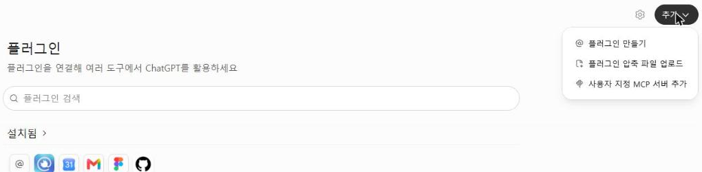

### 2. 파일 넣고 플러그인 추가

**새 플러그인** 창에 받은 ZIP을 끌어다 놓거나 **클릭하여 업로드하세요**를 눌러 고른 뒤 **플러그인
추가**를 누릅니다. ChatGPT가 파일을 검사하는 동안 잠시 기다립니다.

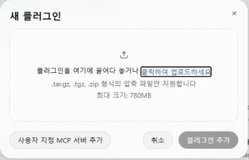

> **사용자 지정 MCP 서버 추가**는 누르지 마세요. 틸노트 연결은 플러그인 안에 이미 들어 있습니다. 따로
> 만들면 틸노트 도구가 두 벌로 보입니다.

### 3. 개인용 탭에서 확인

**개인용** 탭 → **내가 만든 플러그인**에 **Tilnote Blog**가 생기면 올라간 것입니다.

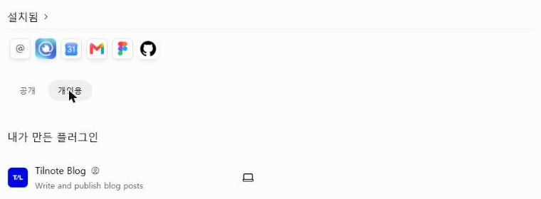

목록에서 Tilnote Blog 옆 노트북 아이콘에 마우스를 올리면 **데스크톱 전용**이라고 나옵니다. 틸노트
연결이 든 플러그인을 직접 올리면 ChatGPT가 이렇게 둡니다. 그래서 웹에서 Tilnote Blog를 열어도 버튼이
**데스크톱 앱에서 열기** 하나뿐입니다. 정상입니다. 설치와 연결은 데스크톱 앱에서 합니다. 제공자
자리에는 올린 사람, 곧 내 ChatGPT 이름이 보입니다.

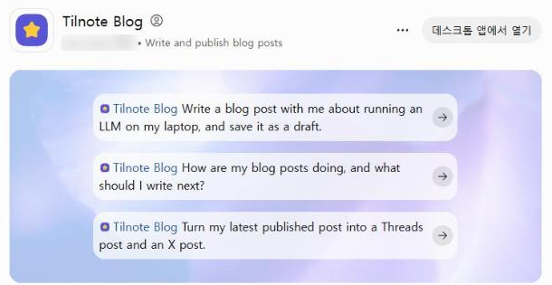

---

## ③ 설치 (데스크톱 앱)

### 4. 플러그인 화면 열기

ChatGPT 데스크톱 앱을 엽니다. 왼쪽 위에서 **ChatGPT**와 **Codex**를 고를 수 있습니다. 플러그인은
둘이 함께 써서, 어느 쪽에서 설치해도 양쪽에서 돕니다. 아래 화면은 Codex입니다.

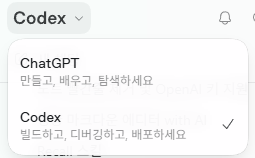

맨 왼쪽 아이콘 줄의 **@(플러그인)** → **개인용** 탭을 누르면 **내가 만든 플러그인**에 Tilnote Blog가
보입니다. 같은 ChatGPT 계정이라 웹에서 올린 것이 그대로 나옵니다.

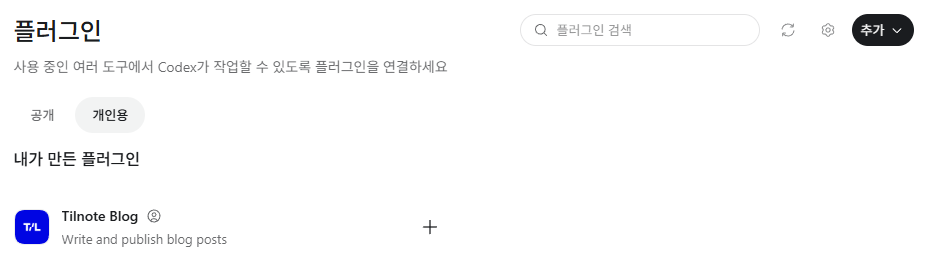

### 5. 플러그인 설치

**Tilnote Blog**를 눌러 열고 오른쪽 위 **플러그인 설치**를 누릅니다.

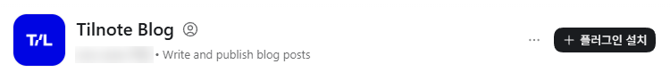

"Tilnote Blog 사용 준비가 완료되었습니다"가 뜨면 **Tilnote Blog 설정**을 누릅니다.

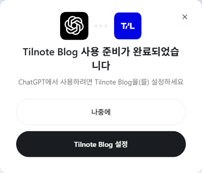

---

## ④ 틸노트 연결

플러그인은 설치됐지만, 아직 내 틸노트 계정에 들어갈 수 없습니다. 로그인은 사람마다 따로 해야 해서
설치할 때 저절로 되지 않습니다. 처음 한 번만 하면 됩니다.

### 6. 설정 대화에서 연결

**Tilnote Blog 설정**을 누르면 새 대화가 열리고, 시작하기 스킬이 저절로 돕니다.


틸노트에 연결하라는 안내가 나오면 **연결**을 누릅니다. 안내가 없으면 Tilnote Blog 화면을 아래로 내려
**MCP 서버** 칸의 **tilnote**에서 연결합니다.

### 7. 틸노트에서 허용

브라우저에 틸노트 화면이 열립니다. 틸노트에 로그인돼 있지 않으면 로그인 화면이 먼저 나옵니다.
로그인하면 아래 동의 화면이 나옵니다.

**연결 계정**이 내가 쓰려는 틸노트 계정인지 확인하고 **허용**을 누릅니다.

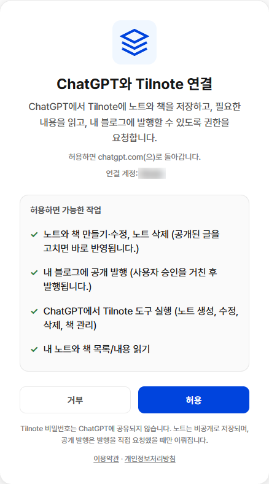

- 틸노트 비밀번호는 ChatGPT에 넘어가지 않습니다.
- 글은 비공개 노트로 저장되고, 내가 "올려줘"라고 할 때만 블로그에 공개됩니다.

### 8. 연결 확인

앱으로 돌아와 Tilnote Blog 화면을 아래로 내리면 **MCP 서버** 칸이 **tilnote · 연결됨**으로 바뀌어
있습니다.

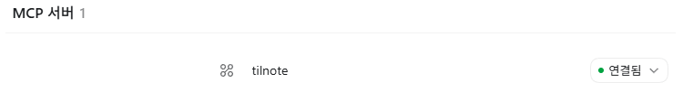

---

## ⑤ 확인: 첫 대화

**새 채팅**을 열고 이렇게 말해 봅니다. ChatGPT·Codex 어느 쪽이든 됩니다. 6번의 설정 대화가 이미
답했다면 그 답을 봐도 됩니다.

```text
틸노트 블로그 처음인데 뭐부터 해?
```

노트 목록 같은 화면이 먼저 몇 개 뜨고, 그 아래에 답이 나옵니다. 1~3분쯤 걸립니다. 내 계정 상태(노트
수, 올린 글, 문체 메모·뉴스 토픽이 있는지, 책)를 읽고, 할 수 있는 일과 첫 걸음 하나를 권하면 연결이
끝난 것입니다. 이 질문에는 아무것도 저장하지 않습니다.

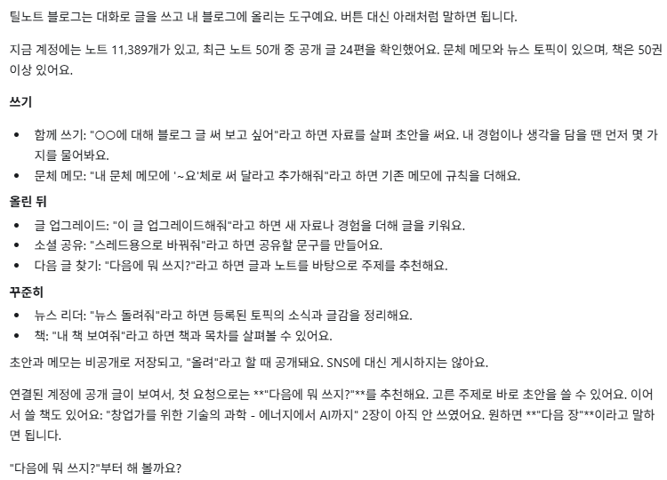

"틸노트가 아직 연결 안 돼 있어"라고 답하면 ④로 돌아가 **MCP 서버** 칸이 **연결됨**인지 확인하세요.

---

## 업데이트

새 파일이 나오면 ①의 주소에서 다시 받고, 웹의 Tilnote Blog 화면 오른쪽 위 **⋯** → **새 버전
업로드**로 올립니다.

## 막힐 때

| 이럴 때 | 이렇게 |
|---|---|
| "업로드한 플러그인의 스킬을 확인하지 못했다"고 답해요 | 웹(chatgpt.com) 대화에서 물은 경우입니다. 스킬은 데스크톱 앱에서 돌아갑니다. 거기서 새 채팅으로 다시 물어보세요 |
| "틸노트가 연결 안 돼 있다"고 답해요 | 데스크톱 앱 → @(플러그인) → 개인용 → Tilnote Blog → **MCP 서버** 칸에서 tilnote가 **연결됨**인지 봅니다 |
| 다른 틸노트 계정으로 연결됐어요 | 브라우저에서 tilnote.io를 로그아웃합니다 → **MCP 서버** 칸의 **연결됨 ⌄** → **다시 연결** → 원하는 계정으로 로그인하고 허용합니다. 동의 화면의 연결 계정이 다르면 그 화면에서 로그아웃해도 됩니다 |
| 틸노트 도구가 두 벌로 보여요 | 예전에 **사용자 지정 MCP 서버 추가**로 직접 만든 틸노트 연결이 있는 경우입니다. 플러그인 화면 **설치됨**에서 그 연결을 끄거나 지웁니다 |
| 연결을 끊고 싶어요 | **MCP 서버** 칸의 **연결됨 ⌄** → **연결 해제** |
| 플러그인을 빼고 싶어요 | 웹의 Tilnote Blog 화면 **⋯** → **플러그인 삭제** |

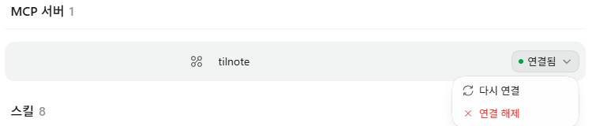

## 다음에 해 볼 말

| 하고 싶은 것 | 이렇게 말하기 |
|---|---|
| 블로그 글 쓰기 | "로컬 LLM에 대해 블로그 글 써 보고 싶어" |
| 다음 글 고르기 | "내 블로그 글 반응 어때? 다음에 뭐 쓰지?" |
| SNS용으로 바꾸기 | "내 최근 공개 글 스레드랑 X용으로 바꿔줘" |
| 관심 분야 소식 받기 | "관심 토픽 등록해줘" → "틸노트 뉴스 리더 돌려줘" |
| 내 말투 남기기 | "내 문체 기억해줘" |
| 책 만들기 | "Git 책 만들어줘" |

초안은 모두 비공개 노트로 저장되고, "올려줘"라고 할 때만 블로그에 공개됩니다.
