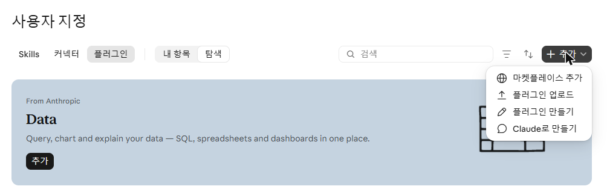
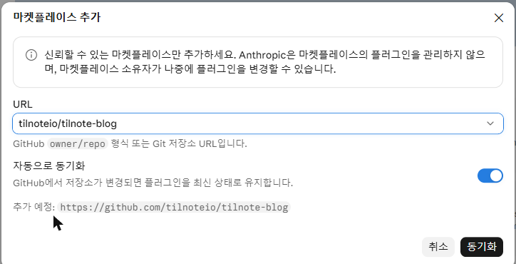
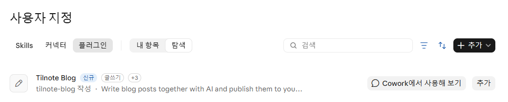
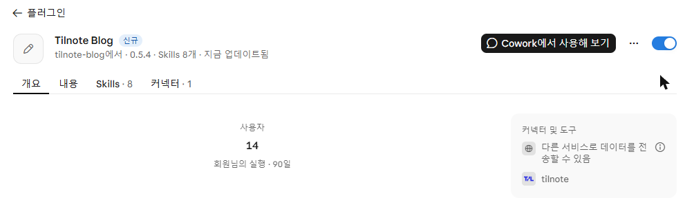
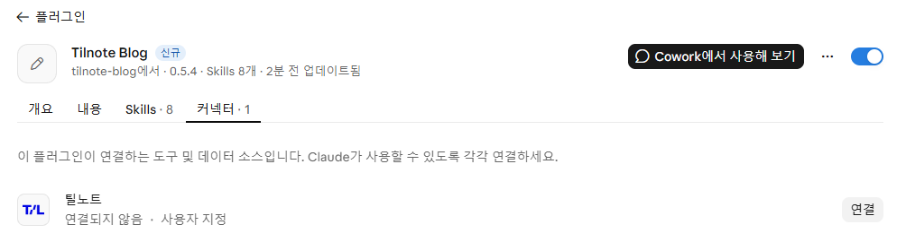
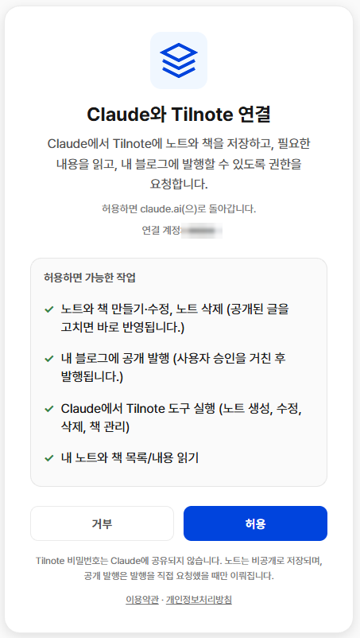
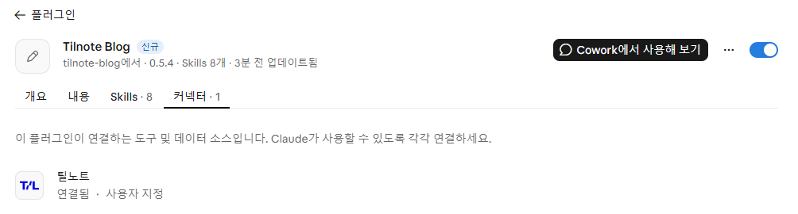
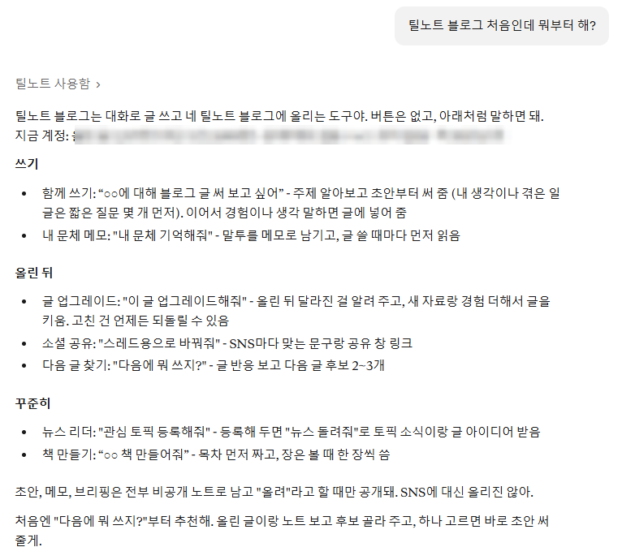

# Claude 웹(claude.ai)에서 틸노트 블로그 연결하기

claude.ai에 Tilnote Blog 플러그인을 넣고 내 틸노트 계정과 연결하는 방법입니다. 처음 한 번만 하면
되고, 5분쯤 걸립니다. 그 뒤로는 새 대화에서 "로컬 LLM에 대해 블로그 글 써 보고 싶어"처럼 말하기만
하면 됩니다.

준비할 것

- claude.ai 유료 요금제 계정. 왼쪽 메뉴의 **사용자 지정**에 **플러그인** 탭이 보여야 합니다.
- 틸노트 계정. 같은 브라우저에서 [tilnote.io](https://tilnote.io)에 미리 로그인해 두면 연결이 더
  빠릅니다.

순서는 세 단계입니다. **① 플러그인 추가 → ② 틸노트 연결 → ③ 확인**

---

## ① 플러그인 추가

### 1. 마켓플레이스 추가 열기

claude.ai 왼쪽 메뉴에서 **사용자 지정** → 위쪽의 **플러그인** 탭 → 오른쪽 위 **+ 추가** →
**마켓플레이스 추가**를 누릅니다.



### 2. 저장소 주소 넣고 동기화

URL 칸에 아래 주소를 넣고 목록에 뜨는 **tilnote-blog**(tilnoteio)를 고른 뒤 **동기화**를 누릅니다.

```text
tilnoteio/tilnote-blog
```



> 동기화 뒤 오른쪽 아래에 "자동으로 동기화하려면 Claude GitHub 앱에 액세스 권한을 부여하라"는 안내가
> 뜰 수 있습니다. 설치와 연결에는 필요 없으니 닫아도 됩니다.

### 3. Tilnote Blog 추가

플러그인 목록에 **Tilnote Blog**가 생깁니다. 오른쪽의 **추가**를 누릅니다.



"Tilnote Blog이(가) 설치되어 사용할 수 있습니다"가 뜨고 플러그인 화면이 열립니다. 오른쪽 위
스위치가 켜져 있고 **Skills · 8**이 보이면 설치된 것입니다.



---

## ② 틸노트 연결

플러그인은 설치됐지만, 아직 내 틸노트 계정에 들어갈 수 없습니다. 로그인은 사람마다 따로 해야 해서
설치할 때 저절로 되지 않습니다. 처음 한 번만 하면 됩니다.

### 4. 커넥터 탭에서 연결

플러그인 화면의 **커넥터** 탭을 누르면 **틸노트 · 연결되지 않음**이 보입니다. 오른쪽 **연결**을
누릅니다. 플러그인 화면은 언제든 [claude.ai/customize/plugins](https://claude.ai/customize/plugins)
→ **내 항목** → **Tilnote Blog**로 다시 열 수 있습니다.

**추가되지 않음**으로 나오면 **추가**를 먼저 누른 뒤 연결합니다. Team·Enterprise 요금제에서는
조직의 Owner가 추가해 줘야 할 수 있습니다.



> **사용자 지정 → 커넥터** 목록에도 같은 **틸노트**가 있습니다. 거기서 연결을 눌러도 똑같습니다.
> 단, **추가 → 사용자 지정 커넥터**로 주소(`https://tilnote.io/mcp`)를 직접 넣어 새로 만들지는 마세요.
> 연결이 두 개가 되어 틸노트 도구가 두 벌로 보입니다.

### 5. 틸노트에서 허용

틸노트 화면으로 넘어갑니다. 틸노트에 로그인돼 있지 않으면 로그인 화면이 먼저 나옵니다. 로그인하면
아래 동의 화면이 나옵니다.

**연결 계정**이 내가 쓰려는 틸노트 계정인지 확인하고 **허용**을 누릅니다.



- 틸노트 비밀번호는 Claude에 넘어가지 않습니다.
- 글은 비공개 노트로 저장되고, 내가 "올려줘"라고 할 때만 블로그에 공개됩니다.

### 6. 연결 확인

claude.ai로 돌아오면 "틸노트에 연결되었습니다"가 뜨고, 커넥터 탭이 **틸노트 · 연결됨**으로
바뀝니다.



---

## ③ 확인: 첫 대화

**새 대화**를 열고 이렇게 말해 봅니다.

```text
틸노트 블로그 처음인데 뭐부터 해?
```

내 계정 상태(올린 글 수, 문체 메모·뉴스 토픽이 있는지, 책)를 읽고, 할 수 있는 일과 첫 걸음 하나를
권하면 연결이 끝난 것입니다. 이 질문에는 아무것도 저장하지 않습니다.



"틸노트가 아직 연결 안 돼 있어"라고 답하면 ②로 돌아가 커넥터 탭이 **연결됨**인지 확인하세요.

---

## 막힐 때

| 이럴 때 | 이렇게 |
|---|---|
| "틸노트가 연결 안 돼 있다"고 답해요 | 플러그인 화면 → 커넥터 탭에서 **틸노트**가 **연결됨**인지 봅니다. 연결되지 않음이면 4번부터 다시 합니다 |
| 틸노트 도구가 두 벌로 보여요 | 예전에 주소로 직접 만든 틸노트 커넥터가 있는 경우입니다. **사용자 지정 → 커넥터**에서 그 커넥터를 끄거나 지웁니다 |
| 다른 틸노트 계정으로 연결됐어요 | **사용자 지정 → 커넥터 → 틸노트 → 연결 해제** → tilnote.io에서 로그아웃하고 원하는 계정으로 로그인 → 4번부터 다시 합니다 |
| 연결을 끊고 싶어요 | **사용자 지정 → 커넥터 → 틸노트 → 연결 해제**. 플러그인을 **제거**해도 연결은 남아 있으니 따로 끊어야 합니다 |

## 다음에 해 볼 말

| 하고 싶은 것 | 이렇게 말하기 |
|---|---|
| 블로그 글 쓰기 | "로컬 LLM에 대해 블로그 글 써 보고 싶어" |
| 다음 글 고르기 | "내 블로그 글 반응 어때? 다음에 뭐 쓰지?" |
| SNS용으로 바꾸기 | "내 최근 공개 글 스레드랑 X용으로 바꿔줘" |
| 관심 분야 소식 받기 | "관심 토픽 등록해줘" → "틸노트 뉴스 리더 돌려줘" |
| 내 말투 남기기 | "내 문체 기억해줘" |
| 책 만들기 | "Git 책 만들어줘" |

초안은 모두 비공개 노트로 저장되고, "올려줘"라고 할 때만 블로그에 공개됩니다.
